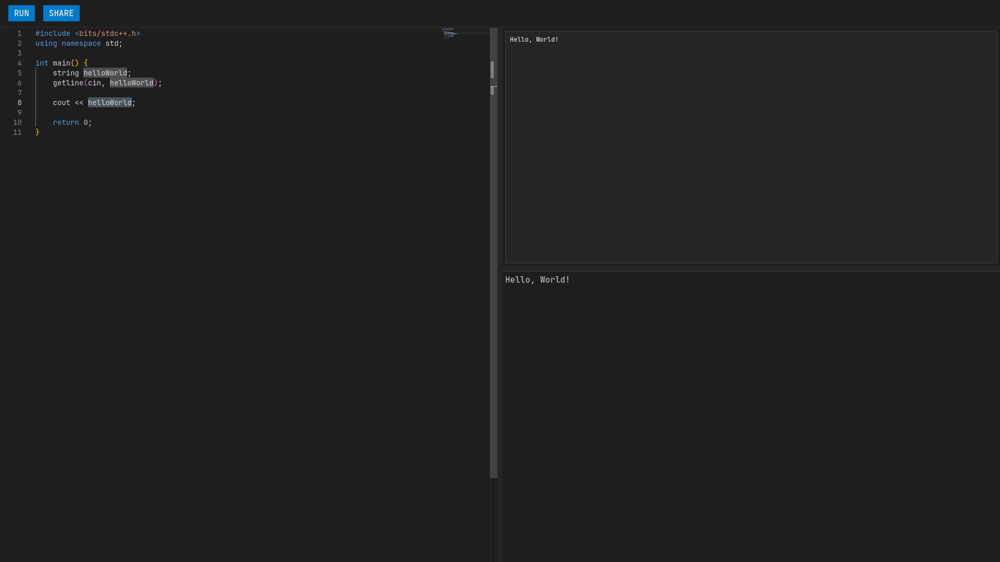
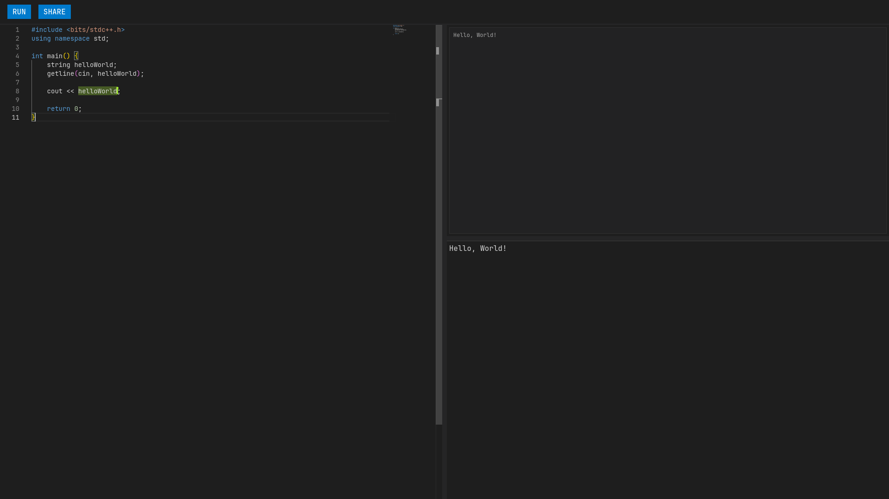

# Live Editor
This is a tool (not a fully fledged IDE) to teach people about one file c++
Live Editor was specifically created for teaching [competitive programming](https://en.wikipedia.org/wiki/Competitive_programming)

## Showcase
**Writer's view**

**Viewer's view**

## Acknowledgments
Inspired by [Realtime Collaborative IDE](https://github.com/cpinitiative/ide) by Competitive Programming Initiative
